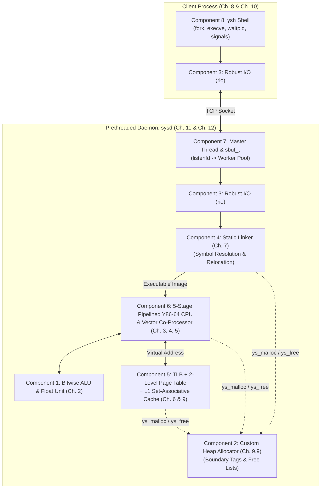

# SysVM: A Networked, Concurrent Y86-64 Execution & Telemetry Platform

## 1. Project Overview

**SysVM** is an end-to-end systems engineering project designed to integrate every core topic from *Computer Systems: A Programmer's Perspective (CS:APP, 3rd Edition)* into a single cohesive system. 

When completed, **SysVM** operates as a complete toolchain, hardware simulator, memory subsystem, concurrent network daemon, and interactive job-control shell:
1. A **static linker** combines relocatable Y86-64 object files into an executable image.
2. A **custom dynamic memory allocator** manages all heap memory for the virtual machine without relying on `libc`'s `malloc`.
3. A **5-stage pipelined Y86-64 processor simulator** executes the linked binary, using a **bitwise ALU & software floating-point unit** and a **CPE-optimized vector co-processor**.
4. All instruction fetches and data accesses pass through a **virtual memory translator (TLB + 2-level page table)** and an **L1 set-associative cache simulator**.
5. A **prethreaded concurrent TCP server** accepts binary payloads over the network using **Robust I/O (`rio`)**, runs them on isolated VM instances, and returns execution and hardware performance counters.
6. An **interactive Unix shell with job control** manages local and remote execution pipelines using processes and signals.

---

## 2. CS:APP Chapter-to-Component Mapping

| Component | Module Files | CS:APP Chapters | Core Concepts Required |
| :--- | :--- | :--- | :--- |
| **1. Bit-Level ALU & Float Codec** | `include/alu_float.h`<br>`src/alu_float.c` | **Chapter 2** | Two's complement overflow detection, bitwise manipulation, little-endian packing, IEEE 754 single-precision float encoding/decoding using integer operations. |
| **2. Custom Heap Allocator** | `include/mm_alloc.h`<br>`src/mm_alloc.c` | **Chapter 9** (§9.9) | Implicit/explicit/segregated free lists, boundary tags (headers/footers), block splitting, immediate coalescing, heap extension via `mmap`/`sbrk`. |
| **3. Robust I/O (`rio`) Layer** | `include/rio.h`<br>`src/rio.c` | **Chapter 10** | Descriptor I/O (`open`, `read`, `write`, `close`), short counts, `EINTR` recovery, buffered thread-safe reading (`rio_t`). |
| **4. Static Relocatable Linker** | `include/linker.h`<br>`src/linker.c` | **Chapter 7** | Symbol tables, strong vs. weak symbol resolution Rules 1–3, section merging, `R_Y86_ABS64` and `R_Y86_PC32` relocation patching. |
| **5. VM & Cache Hierarchy** | `include/mem_sim.h`<br>`src/mem_sim.c` | **Chapters 6 & 9** (§9.1–9.8) | $(S, E, B, m)$ cache organization, tag/index/offset extraction, LRU eviction, write-back dirty bits, VPN/VPO split, TLB lookup, 2-level page table walk, page faults. |
| **6. Pipelined Y86-64 CPU & Vector Unit** | `include/pipe_cpu.h`<br>`src/pipe_cpu.c` | **Chapters 3, 4, & 5** | ISA encoding, condition codes (`ZF`, `SF`, `OF`), 5-stage pipeline registers (`F`, `D`, `E`, `M`, `W`), data forwarding, load/use stalling, branch misprediction, loop unrolling, multiple accumulators, cache blocking. |
| **7. Concurrent Execution Server** | `include/server.h`<br>`src/server.c` | **Chapters 11 & 12** | Sockets interface (`getaddrinfo`, `socket`, `bind`, `listen`, `accept`), POSIX threads, producer-consumer bounded buffer (`sbuf_t`), mutexes/condition variables, reader-writer synchronization, reentrancy. |
| **8. Job-Control Client Shell** | `include/ysh.h`<br>`src/ysh.c` | **Chapter 8** | Process control (`fork`, `execve`, `waitpid`, `setpgid`), signals (`SIGCHLD`, `SIGINT`, `SIGTSTP`), `sigprocmask` race prevention, `sigsuspend`. |

---

## 3. System Architecture



---

## 4. Recommended Project Layout

```text
project/
├── Makefile
├── README.md
├── include/
│   ├── alu_float.h     # Component 1 (Ch. 2)
│   ├── mm_alloc.h      # Component 2 (Ch. 9.9)
│   ├── rio.h           # Component 3 (Ch. 10)
│   ├── linker.h        # Component 4 (Ch. 7)
│   ├── mem_sim.h       # Component 5 (Ch. 6, 9.1-9.8)
│   ├── pipe_cpu.h      # Component 6 (Ch. 3, 4, 5)
│   ├── server.h        # Component 7 (Ch. 11, 12)
│   └── ysh.h           # Component 8 (Ch. 8)
├── src/
│   ├── alu_float.c
│   ├── mm_alloc.c
│   ├── rio.c
│   ├── linker.c
│   ├── mem_sim.c
│   ├── pipe_cpu.c
│   ├── server.c
│   └── ysh.c
└── tests/
    └── test_runner.c   # Unit tests for each component
```

---

## 5. Build System Skeleton (`Makefile`)

```makefile
CC      = gcc
CFLAGS  = -Wall -Wextra -Werror -std=c11 -O2 -g -Iinclude -D_POSIX_C_SOURCE=200809L
LDFLAGS = -lpthread

COMMON_SRCS = src/alu_float.c src/mm_alloc.c src/rio.c src/linker.c src/mem_sim.c src/pipe_cpu.c
COMMON_OBJS = $(COMMON_SRCS:.c=.o)

all: sysd ysh

sysd: $(COMMON_OBJS) src/server.o
	$(CC) $(CFLAGS) -o $@ $^ $(LDFLAGS)

ysh: $(COMMON_OBJS) src/ysh.o
	$(CC) $(CFLAGS) -o $@ $^ $(LDFLAGS)

%.o: %.c
	$(CC) $(CFLAGS) -c -o $@ $<

clean:
	rm -f src/*.o sysd ysh
```

---

## 6. Component Specifications, Starting Hints & Skeleton Code

---

### Component 1: Bit-Level ALU & Software Float Codec (`alu_float`)
**CS:APP Reference:** Chapter 2 (*Representing and Manipulating Information*, §2.1–§2.4)

#### Requirements
1. Implement little-endian byte extraction and packing (`read_le64`, `write_le64`, `read_le32`, `write_le32`) using only bit shifts and masks.
2. Implement 64-bit two's complement ALU operations (`ALU_ADD`, `ALU_SUB`, `ALU_AND`, `ALU_XOR`) and compute condition codes `ZF` (Zero), `SF` (Sign), and `OF` (Overflow) without using wider integer types (such as `__int128`) or compiler intrinsics. Note that in Y86-64, `SUBQ rA, rB` computes `valB - valA`.
3. Implement a software IEEE 754 single-precision (`float_bits` = `uint32_t`) negation, int-to-float conversion, and addition (`f32_negate`, `f32_from_i64`, `f32_add`) handling normalized numbers, denormalized numbers, `NaN`, `±Infinity`, and round-to-even using strictly integer/bitwise operations.

> **Where to Start:** Begin by implementing `read_le64` and `alu_execute`, deriving the two's complement overflow flag `OF` from the sign bits of the two operands and the result before tackling IEEE 754 bit fields.

#### Self-Check Verification Targets
- `alu_execute(ALU_ADD, INT64_MAX, 1, &cc)` $\rightarrow$ returns `INT64_MIN` with `cc = {.zf = 0, .sf = 1, .of = 1}`.
- `alu_execute(ALU_SUB, 1, INT64_MIN, &cc)` (`INT64_MIN - 1`) $\rightarrow$ returns `INT64_MAX` with `cc = {.zf = 0, .sf = 0, .of = 1}`.
- `f32_from_i64(0x1FFFFFE)` (`33554430`) vs `f32_from_i64(0x1FFFFFF)` (`33554431`) $\rightarrow$ verifies round-to-even on the least significant bit when guard and round bits are `10...0`.

#### Header Skeleton (`include/alu_float.h`)
```c
#ifndef ALU_FLOAT_H
#define ALU_FLOAT_H

#include <stdint.h>
#include <stdbool.h>

typedef uint32_t float_bits;

/* IEEE 754 single-precision bit layout constants */
#define F32_SIGN_SHIFT 31
#define F32_EXP_SHIFT  23
#define F32_EXP_MASK   0xFFU
#define F32_FRAC_MASK  0x7FFFFFU
#define F32_BIAS       127

typedef enum {
    ALU_ADD = 0,
    ALU_SUB = 1,
    ALU_AND = 2,
    ALU_XOR = 3
} alu_op_t;

typedef struct {
    bool zf; /* Zero Flag */
    bool sf; /* Sign Flag */
    bool of; /* Overflow Flag */
} cc_t;

/* Little-endian packing/unpacking */
uint32_t read_le32(const uint8_t buf[4]);
void     write_le32(uint8_t buf[4], uint32_t val);
uint64_t read_le64(const uint8_t buf[8]);
void     write_le64(uint8_t buf[8], uint64_t val);

/* Integer ALU with condition code generation (SUB computes b - a) */
int64_t  alu_execute(alu_op_t op, int64_t a, int64_t b, cc_t *cc_out);

/* Bit-level IEEE 754 single-precision operations (no float/double casts allowed) */
float_bits f32_negate(float_bits f);
float_bits f32_from_i64(int64_t x);
float_bits f32_add(float_bits a, float_bits b);

#endif /* ALU_FLOAT_H */
```

#### Implementation Skeleton (`src/alu_float.c`)
```c
#include "alu_float.h"

uint32_t read_le32(const uint8_t buf[4]) {
    /* TODO: Reconstruct 32-bit unsigned integer from 4 little-endian bytes */
    (void)buf;
    return 0;
}

void write_le32(uint8_t buf[4], uint32_t val) {
    /* TODO: Write 32-bit unsigned integer into 4 little-endian bytes */
    (void)buf; (void)val;
}

uint64_t read_le64(const uint8_t buf[8]) {
    /* TODO: Reconstruct 64-bit unsigned integer from 8 little-endian bytes */
    (void)buf;
    return 0;
}

void write_le64(uint8_t buf[8], uint64_t val) {
    /* TODO: Write 64-bit unsigned integer into 8 little-endian bytes */
    (void)buf; (void)val;
}

int64_t alu_execute(alu_op_t op, int64_t a, int64_t b, cc_t *cc_out) {
    /* TODO:
     * 1. Compute result using unsigned casts to avoid C signed-overflow UB.
     * 2. Note Y86-64 operand order: ALU_SUB computes b - a.
     * 3. Set cc_out->zf (result == 0), cc_out->sf (result < 0),
     *    and cc_out->of (0 for AND/XOR; sign-bit formula for ADD/SUB).
     */
    (void)op; (void)a; (void)b; (void)cc_out;
    return 0;
}

float_bits f32_negate(float_bits f) {
    /* TODO: If exp == 0xFF and frac != 0 (NaN), return f unchanged; else flip bit 31 */
    (void)f;
    return 0;
}

float_bits f32_from_i64(int64_t x) {
    /* TODO:
     * 1. Handle 0 and INT64_MIN edge cases.
     * 2. Extract sign and absolute magnitude |x| as uint64_t.
     * 3. Find highest set bit position (msb), normalize into 23-bit fraction.
     * 4. If msb > 23, apply IEEE 754 round-to-even using guard, round, and sticky bits.
     */
    (void)x;
    return 0;
}

float_bits f32_add(float_bits a, float_bits b) {
    /* TODO:
     * 1. Handle NaN and +/-Infinity special cases.
     * 2. Unpack sign, effective exponent, and 24-bit significand (with implicit 1 for normalized).
     * 3. Align smaller exponent by right-shifting its significand (accumulating sticky bit).
     * 4. Add or subtract aligned significands, re-normalize, and round-to-even.
     */
    (void)a; (void)b;
    return 0;
}
```

---

### Component 2: Custom Dynamic Memory Allocator (`mm_alloc`)
**CS:APP Reference:** Chapter 9, Section 9.9 (*Dynamic Memory Allocation*, Figure 9.43–9.47)

#### Requirements
1. Request raw virtual memory pages from the OS via `mmap` inside `ys_mm_init` and `extend_heap`.
2. Maintain 16-byte (`DSIZE`) alignment for all returned payloads, with an 8-byte alignment pad, 16-byte prologue block, 8-byte epilogue header, and 8-byte boundary tags (header and footer packing block size and allocation bit).
3. Implement `find_fit` (first-fit or next-fit), `place` (splitting blocks when the remainder is $\ge 32\text{ bytes}$), and `coalesce` across all four adjacent-block cases (CS:APP Figure 9.40).
4. Provide a heap consistency checker `ys_mm_check()` that verifies block alignment, header/footer match, no contiguous free blocks, and heap bounds.

> **Where to Start:** Start by writing the boundary-tag macros (`PACK`, `GET`, `PUT`, `HDRP`, `FTRP`, `NEXT_BLKP`, `PREV_BLKP`) and implementing `ys_mm_init` + `extend_heap` to pass `ys_mm_check()` on an empty heap before adding `find_fit` and `place`.

#### Self-Check Verification Targets
- After `ys_mm_init()`, `ys_mm_check()` returns `true`.
- Allocating two adjacent 32-byte blocks `p1`, `p2` and freeing `p1` then `p2` coalesces them into a single free block (verified by `ys_mm_check()` finding zero contiguous free blocks).
- All returned pointers satisfy `((uintptr_t)p % 16) == 0`.

#### Header Skeleton (`include/mm_alloc.h`)
```c
#ifndef MM_ALLOC_H
#define MM_ALLOC_H

#include <stddef.h>
#include <stdbool.h>

#define MM_ALIGNMENT 16

int   ys_mm_init(void);
void *ys_malloc(size_t size);
void  ys_free(void *ptr);
void *ys_realloc(void *ptr, size_t size);
bool  ys_mm_check(void);
void  ys_mm_destroy(void);

#endif /* MM_ALLOC_H */
```

#### Implementation Skeleton (`src/mm_alloc.c`)
```c
#include "mm_alloc.h"
#include <stdint.h>
#include <string.h>
#include <sys/mman.h>

/* Basic constants for 64-bit boundary tags (CS:APP Fig. 9.43 adapted to 8-byte words) */
#define WSIZE     8               /* Word and header/footer size (bytes) */
#define DSIZE     16              /* Double word size / alignment (bytes) */
#define CHUNKSIZE (1 << 12)       /* Extend heap by this amount (4096 bytes) */
#define MAX_HEAP  (16 * 1024 * 1024) /* 16 MB backing arena */

/* TODO: Define boundary-tag macros:
 *   PACK(size, alloc)
 *   GET(p), PUT(p, val)
 *   GET_SIZE(p), GET_ALLOC(p)
 *   HDRP(bp), FTRP(bp)
 *   NEXT_BLKP(bp), PREV_BLKP(bp)
 */

static uint8_t *arena_base = NULL;
static uint8_t *arena_brk  = NULL;
static uint8_t *heap_listp = NULL;

static void *mem_sbrk(intptr_t incr) {
    /* Moves arena_brk within the mmap'd arena_base [0 .. MAX_HEAP] */
    if (!arena_base || incr < 0 || (size_t)((arena_brk - arena_base) + incr) > MAX_HEAP) {
        return (void *)-1;
    }
    void *old_brk = arena_brk;
    arena_brk += incr;
    return old_brk;
}

static void *coalesce(void *bp) {
    /* TODO: Check prev_alloc and next_alloc (Cases 1-4 in CS:APP Fig 9.40), merge headers/footers */
    (void)bp;
    return NULL;
}

static void *extend_heap(size_t words) {
    /* TODO: Round words up to even count, call mem_sbrk, init free block header/footer & new epilogue, coalesce */
    (void)words; (void)mem_sbrk; (void)coalesce;
    return NULL;
}

static void *find_fit(size_t asize) {
    /* TODO: Traverse heap starting at heap_listp until epilogue (size == 0), return first free block >= asize */
    (void)asize;
    return NULL;
}

static void place(void *bp, size_t asize) {
    /* TODO: If (csize - asize) >= 2*DSIZE, split block and mark remainder free; else allocate full csize */
    (void)bp; (void)asize;
}

int ys_mm_init(void) {
    /* TODO:
     * 1. mmap MAX_HEAP anonymous private memory into arena_base, set arena_brk = arena_base.
     * 2. Allocate 4 words via mem_sbrk: alignment pad, prologue header, prologue footer, epilogue header.
     * 3. Set heap_listp to prologue payload and call extend_heap(CHUNKSIZE / WSIZE).
     */
    (void)heap_listp; (void)extend_heap;
    return -1;
}

void *ys_malloc(size_t size) {
    /* TODO: Adjust size to include overhead (DSIZE) and 16-byte alignment, search via find_fit, place or extend_heap */
    (void)size; (void)find_fit; (void)place;
    return NULL;
}

void ys_free(void *ptr) {
    /* TODO: Ignore NULL; clear alloc bit in HDRP(ptr) and FTRP(ptr), then call coalesce(ptr) */
    (void)ptr;
}

void *ys_realloc(void *ptr, size_t size) {
    /* TODO: Handle ptr == NULL (malloc) and size == 0 (free); otherwise allocate new block, memcpy min(old, size), free old */
    (void)ptr; (void)size;
    return NULL;
}

bool ys_mm_check(void) {
    /* TODO: Verify prologue/epilogue, 16-byte alignment, HDRP == FTRP, and no two consecutive free blocks */
    return false;
}

void ys_mm_destroy(void) {
    if (arena_base) {
        munmap(arena_base, MAX_HEAP);
        arena_base = arena_brk = heap_listp = NULL;
    }
}
```

---

### Component 3: Robust I/O (`rio`) Layer (`rio`)
**CS:APP Reference:** Chapter 10 (*System-Level I/O*, §10.5, Figures 10.4 & 10.5)

#### Requirements
1. Implement unbuffered `rio_readn` and `rio_writen` that loop until the requested byte count is transferred, transparently restarting interrupted system calls (`errno == EINTR`) and handling short counts.
2. Implement buffered input functions (`rio_readinitb`, `rio_readnb`, `rio_readlineb`) using an internal per-descriptor buffer (`rio_t`) so network sockets and pipes can be parsed line-by-line or chunk-by-chunk safely across threads.

> **Where to Start:** Implement the unbuffered `rio_readn` and `rio_writen` loops first by checking the return value of `read`/`write` for `EINTR` and updating the remaining byte counter on partial transfers.

#### Self-Check Verification Targets
- Create a `pipe(fds)`, write 20,000 bytes in small chunks from one end, and verify `rio_readn` reconstructs all 20,000 bytes despite pipe buffer short counts.
- Send `"HELLO\nWORLD\n"` into a pipe and verify two consecutive calls to `rio_readlineb` return `6` (`"HELLO\n"`) and `6` (`"WORLD\n"`), followed by `0` on `EOF`.

#### Header Skeleton (`include/rio.h`)
```c
#ifndef RIO_H
#define RIO_H

#include <sys/types.h>
#include <stddef.h>

#define RIO_BUFSIZE 8192

typedef struct {
    int     rio_fd;                /* Descriptor for this internal buf */
    ssize_t rio_cnt;               /* Unread bytes in internal buf */
    char   *rio_bufptr;            /* Next unread byte in internal buf */
    char    rio_buf[RIO_BUFSIZE];  /* Internal buffer */
} rio_t;

ssize_t rio_readn(int fd, void *usrbuf, size_t n);
ssize_t rio_writen(int fd, const void *usrbuf, size_t n);

void    rio_readinitb(rio_t *rp, int fd);
ssize_t rio_readnb(rio_t *rp, void *usrbuf, size_t n);
ssize_t rio_readlineb(rio_t *rp, void *usrbuf, size_t maxlen);

#endif /* RIO_H */
```

#### Implementation Skeleton (`src/rio.c`)
```c
#include "rio.h"
#include <unistd.h>
#include <errno.h>
#include <string.h>

static ssize_t rio_read(rio_t *rp, char *usrbuf, size_t n) {
    /* TODO: While rp->rio_cnt <= 0, refill rp->rio_buf via read() (restarting on EINTR).
     * Then memcpy min(n, rp->rio_cnt) bytes to usrbuf and advance rp->rio_bufptr. (CS:APP Fig 10.5)
     */
    (void)rp; (void)usrbuf; (void)n;
    return -1;
}

ssize_t rio_readn(int fd, void *usrbuf, size_t n) {
    /* TODO: Read up to n bytes unbuffered, handling short counts and EINTR (CS:APP Fig 10.4) */
    (void)fd; (void)usrbuf; (void)n;
    return -1;
}

ssize_t rio_writen(int fd, const void *usrbuf, size_t n) {
    /* TODO: Write exactly n bytes unbuffered, handling short counts and EINTR (CS:APP Fig 10.4) */
    (void)fd; (void)usrbuf; (void)n;
    return -1;
}

void rio_readinitb(rio_t *rp, int fd) {
    /* TODO: Associate descriptor fd with read buffer rp and reset rio_cnt and rio_bufptr */
    (void)rp; (void)fd; (void)rio_read;
}

ssize_t rio_readnb(rio_t *rp, void *usrbuf, size_t n) {
    /* TODO: Loop calling rio_read() until n bytes are read or EOF is reached */
    (void)rp; (void)usrbuf; (void)n;
    return -1;
}

ssize_t rio_readlineb(rio_t *rp, void *usrbuf, size_t maxlen) {
    /* TODO: Read 1 byte at a time via rio_read() up to maxlen-1 bytes stopping at '\n' or EOF, null-terminate */
    (void)rp; (void)usrbuf; (void)maxlen;
    return -1;
}
```

---

### Component 4: Relocatable Y86-64 Static Linker (`linker`)
**CS:APP Reference:** Chapter 7 (*Linking*, §7.6–§7.7, Figure 7.9–7.10)

#### Requirements
1. **Section Layout (`assign_section_bases`)**: Concatenate all `.text` sections starting at runtime address `0x0000`, align the end of `.text` up to the next 64-byte boundary, and concatenate all `.data` sections after `.text`.
2. **Symbol Resolution (`resolve_global_symbols`)**: Resolve global symbols across modules enforcing CS:APP §7.6.1 rules:
   - **Rule 1:** Multiple strong symbols (`SYM_STRONG`) with the same name return `-1` (link error).
   - **Rule 2:** Given one strong symbol and one or more weak symbols (`SYM_WEAK`), choose the strong symbol.
   - **Rule 3:** Given multiple weak symbols, choose the first weak symbol encountered.
   - Any relocation referencing a symbol that remains `SYM_UNDEF` returns `-1`.
3. **Relocation (`apply_relocations`)**: Patch every `y86_reloc_t` entry in the merged output image using CS:APP §7.7.2 equations:
   - First compute `refaddr = module_section_base + reloc.offset`.
   - If `reloc.type == R_Y86_ABS64`: write 64-bit `(uint64_t)(ADDR(r.symbol) + r.addend)` at `image + refaddr` using `write_le64`.
   - If `reloc.type == R_Y86_PC32`: write 32-bit `(uint32_t)(ADDR(r.symbol) + r.addend - refaddr)` at `image + refaddr` using `write_le32`.

> **Where to Start:** Write `assign_section_bases` first to assign runtime start addresses to each module's `.text` and `.data` sections, then implement `resolve_global_symbols` using the three strong/weak rules before coding `apply_relocations`.

#### Self-Check Verification Targets
- Linking two modules that both define `SYM_STRONG` `"foo"` returns `-1`.
- Linking Module A (`SYM_WEAK` `"x"` at `.data+0`) and Module B (`SYM_STRONG` `"x"` at `.data+8`) resolves `"x"` to Module B's runtime `.data` address.
- An `R_Y86_ABS64` relocation in Module A referencing `"main"` in Module B writes Module B's `.text` base address into the target instruction's 8-byte immediate field.

#### Header Skeleton (`include/linker.h`)
```c
#ifndef LINKER_H
#define LINKER_H

#include <stdint.h>
#include <stddef.h>
#include <stdbool.h>

#define MAX_GLOBAL_SYMS 256

typedef enum {
    SYM_UNDEF  = 0,
    SYM_STRONG = 1,
    SYM_WEAK   = 2
} sym_bind_t;

typedef enum {
    SEC_TEXT = 0,
    SEC_DATA = 1
} sec_type_t;

typedef struct {
    char       name[64];
    sym_bind_t binding;
    sec_type_t section;
    uint64_t   offset;   /* Offset within module's section */
    uint64_t   size;
} y86_sym_t;

typedef enum {
    R_Y86_ABS64 = 0,     /* 64-bit absolute address reference */
    R_Y86_PC32  = 1      /* 32-bit PC-relative reference */
} rel_type_t;

typedef struct {
    uint64_t   offset;   /* Section offset of reference to patch */
    sec_type_t section;  /* Section where reference resides (SEC_TEXT or SEC_DATA) */
    char       symbol[64];
    rel_type_t type;
    int64_t    addend;
} y86_reloc_t;

typedef struct {
    uint8_t     *text;
    size_t       text_size;
    uint8_t     *data;
    size_t       data_size;
    y86_sym_t   *symtab;
    size_t       sym_count;
    y86_reloc_t *relocs;
    size_t       reloc_count;
} y86_obj_t;

typedef struct {
    char       name[64];
    sym_bind_t binding;
    uint64_t   runtime_addr; /* Resolved final virtual address */
} resolved_sym_t;

typedef struct {
    uint8_t *image;      /* Contiguous linked binary image (allocated via ys_malloc) */
    size_t   image_size;
    uint64_t entry_pc;   /* Resolved address of "main" */
} y86_exec_t;

int link_objects(const y86_obj_t *objs, size_t n_objs, y86_exec_t *exec_out);

#endif /* LINKER_H */
```

#### Implementation Skeleton (`src/linker.c`)
```c
#include "linker.h"
#include "alu_float.h"
#include "mm_alloc.h"
#include <string.h>

static size_t assign_section_bases(const y86_obj_t *objs, size_t n_objs,
                                   uint64_t *text_bases, uint64_t *data_bases) {
    /* TODO:
     * 1. Place objs[i].text sequentially starting at 0x0, recording text_bases[i].
     * 2. Align total text size up to next multiple of 64: (offset + 63) & ~63ULL.
     * 3. Place objs[i].data sequentially after aligned text, recording data_bases[i].
     * 4. Return total merged image size in bytes.
     */
    (void)objs; (void)n_objs; (void)text_bases; (void)data_bases;
    return 0;
}

static int resolve_global_symbols(const y86_obj_t *objs, size_t n_objs,
                                  const uint64_t *text_bases, const uint64_t *data_bases,
                                  resolved_sym_t *globals, size_t *n_globals_out) {
    /* TODO:
     * Iterate through all defined symbols (binding != SYM_UNDEF) in objs[0..n_objs-1].
     * Compute sym's runtime_addr = (section == SEC_TEXT ? text_bases[i] : data_bases[i]) + sym.offset.
     * Apply CS:APP §7.6.1 Rules 1, 2, and 3 when a symbol name already exists in globals[].
     * Return 0 on success, -1 on duplicate strong symbol error.
     */
    (void)objs; (void)n_objs; (void)text_bases; (void)data_bases; (void)globals; (void)n_globals_out;
    return -1;
}

static int apply_relocations(const y86_obj_t *objs, size_t n_objs,
                             const uint64_t *text_bases, const uint64_t *data_bases,
                             const resolved_sym_t *globals, size_t n_globals,
                             uint8_t *image) {
    /* TODO:
     * For each module i and each relocation r in objs[i].relocs:
     * 1. Look up r.symbol in globals[0..n_globals-1]; return -1 if not found.
     * 2. Compute refaddr = (r.section == SEC_TEXT ? text_bases[i] : data_bases[i]) + r.offset.
     * 3. Patch image + refaddr using write_le64 (R_Y86_ABS64) or write_le32 (R_Y86_PC32).
     */
    (void)objs; (void)n_objs; (void)text_bases; (void)data_bases;
    (void)globals; (void)n_globals; (void)image;
    return -1;
}

int link_objects(const y86_obj_t *objs, size_t n_objs, y86_exec_t *exec_out) {
    /* TODO:
     * 1. Call assign_section_bases().
     * 2. Call resolve_global_symbols() and verify "main" is defined.
     * 3. Allocate exec_out->image via ys_malloc(image_size), zero it, and copy all .text and .data sections.
     * 4. Call apply_relocations() and set exec_out->entry_pc to runtime_addr of "main".
     */
    (void)assign_section_bases; (void)resolve_global_symbols; (void)apply_relocations;
    (void)objs; (void)n_objs; (void)exec_out;
    return -1;
}
```

---

### Component 5: Virtual Memory & Cache Hierarchy Simulator (`mem_sim`)
**CS:APP Reference:** Chapter 6 (*The Memory Hierarchy*, §6.4) & Chapter 9 (*Virtual Memory*, §9.3–§9.6)

#### Requirements
1. Implement virtual-to-physical address translation for a 16-bit virtual address space ($m = 16$, page size $P = 256\text{ bytes} \implies 8\text{-bit VPO}, 8\text{-bit VPN}$ split into `VPN1 = vaddr[15:12]` and `VPN2 = vaddr[11:8]`):
   - Check the 4-way set-associative **TLB** (`tlb_lookup`).
   - On a TLB miss, walk the **2-level page table** (`l1_pt[vpn1][vpn2]`).
   - On a page fault (`valid == 0`), invoke `handle_page_fault` to allocate the next physical frame `ppn`, copy the 256-byte page from `backing_store`, mark the PTE valid, and insert the mapping into the TLB (`tlb_insert`).
2. Route the translated physical address through a configurable $(s, E, b)$ **L1 Cache** (`l1_access`):
   - Extract set index `s` bits and tag bits from `paddr`.
   - Update `cache_hits`, `cache_misses`, and `cache_evictions` using `ms->clock` for strict **LRU** replacement.
   - Implement **write-back, write-allocate**: on a write, mark the cache line `dirty = true`; when evicting a dirty line, write its block back to `phys_mem` before loading the new block.

> **Where to Start:** Implement `l1_access` and its LRU replacement logic on physical addresses first (using bit shifts and masks to extract block offset, set index, and tag), then implement `translate_address` with the TLB and 2-level page table in front of it.

#### Self-Check Verification Targets
- Reading byte at `vaddr = 0x0100` for the first time records `tlb_misses = 1`, `page_faults = 1`, `cache_misses = 1`.
- Reading byte at `vaddr = 0x0101` immediately afterward records `tlb_hits = 1`, `page_faults = 1` (unchanged), `cache_hits = 1` (spatial locality within the same cache block and page).

#### Header Skeleton (`include/mem_sim.h`)
```c
#ifndef MEM_SIM_H
#define MEM_SIM_H

#include <stdint.h>
#include <stddef.h>
#include <stdbool.h>

#define VM_VADDR_BITS 16
#define VM_PAGE_SHIFT 8
#define VM_PAGE_SIZE  (1 << VM_PAGE_SHIFT) /* 256 bytes per page */
#define PHYS_MEM_SIZE 65536                /* 64 KB physical RAM (256 frames) */

typedef struct {
    bool     valid;
    bool     dirty;
    uint64_t tag;
    uint64_t lru_clock;
    uint8_t *block;      /* Block payload of B = 2^b bytes (or 1 byte for TLB PPN) */
} cache_line_t;

typedef struct {
    int           s;     /* Number of set index bits (S = 2^s) */
    int           E;     /* Lines per set */
    int           b;     /* Number of block offset bits (B = 2^b) */
    cache_line_t *lines; /* Flat array of S * E cache lines: set i starts at lines[i * E] */
} cache_t;

typedef struct {
    bool    valid;
    bool    dirty;
    uint8_t ppn;         /* Physical Page Number (0..255) */
} pte_t;

typedef struct {
    uint64_t tlb_hits;
    uint64_t tlb_misses;
    uint64_t page_faults;
    uint64_t cache_hits;
    uint64_t cache_misses;
    uint64_t cache_evictions;
} mem_stats_t;

typedef struct {
    cache_t     l1;
    cache_t     tlb;             /* 4 sets (s=2), 4 ways (E=4), b=0 storing PPN in block[0] */
    pte_t      *l1_pt[16];       /* 2-level page table: 16 L1 entries -> 16 L2 entries */
    uint8_t     phys_mem[PHYS_MEM_SIZE];
    uint8_t     backing_store[PHYS_MEM_SIZE];
    uint8_t     next_free_ppn;
    uint64_t    clock;
    mem_stats_t stats;
} mem_system_t;

int  mem_init(mem_system_t *ms, int s, int E, int b, const uint8_t *image, size_t image_size);
int  mem_read_byte(mem_system_t *ms, uint64_t vaddr, uint8_t *val_out);
int  mem_write_byte(mem_system_t *ms, uint64_t vaddr, uint8_t val);
int  mem_read_u64(mem_system_t *ms, uint64_t vaddr, uint64_t *val_out);
int  mem_write_u64(mem_system_t *ms, uint64_t vaddr, uint64_t val);
void mem_destroy(mem_system_t *ms);

#endif /* MEM_SIM_H */
```

#### Implementation Skeleton (`src/mem_sim.c`)
```c
#include "mem_sim.h"
#include "mm_alloc.h"
#include "alu_float.h"
#include <string.h>

static bool tlb_lookup(mem_system_t *ms, uint8_t vpn, uint8_t *ppn_out) {
    /* TODO: Extract TLB set index (vpn & 0x3) and tag (vpn >> 2), search E=4 lines, update lru_clock on hit */
    (void)ms; (void)vpn; (void)ppn_out;
    return false;
}

static void tlb_insert(mem_system_t *ms, uint8_t vpn, uint8_t ppn) {
    /* TODO: Insert VPN -> PPN into TLB set using invalid slot or LRU victim */
    (void)ms; (void)vpn; (void)ppn;
}

static uint8_t handle_page_fault(mem_system_t *ms, uint8_t vpn) {
    /* TODO:
     * 1. Increment ms->stats.page_faults.
     * 2. Allocate frame ppn = ms->next_free_ppn++.
     * 3. Copy 256 bytes from ms->backing_store[vpn * 256] into ms->phys_mem[ppn * 256].
     * 4. Allocate L2 page table if ms->l1_pt[vpn >> 4] == NULL, set PTE valid=true, ppn=ppn.
     */
    (void)ms; (void)vpn;
    return 0;
}

static int translate_address(mem_system_t *ms, uint64_t vaddr, uint64_t *paddr_out) {
    /* TODO:
     * 1. Verify vaddr < PHYS_MEM_SIZE; extract vpn = (vaddr >> 8) & 0xFF and vpo = vaddr & 0xFF.
     * 2. Check tlb_lookup(); on miss, walk ms->l1_pt[vpn >> 4][vpn & 0xF], calling handle_page_fault() if needed, then tlb_insert().
     * 3. Construct *paddr_out = ((uint64_t)ppn << 8) | vpo.
     */
    (void)tlb_lookup; (void)tlb_insert; (void)handle_page_fault;
    (void)ms; (void)vaddr; (void)paddr_out;
    return -1;
}

static void l1_access(mem_system_t *ms, uint64_t paddr, bool is_write, uint8_t *val_inout) {
    /* TODO:
     * 1. Extract block offset (b bits), set index (s bits), and tag from paddr.
     * 2. Search set for matching valid tag:
     *    - Hit: increment cache_hits, update lru_clock, read/write block[offset], set dirty on write.
     *    - Miss: increment cache_misses, pick invalid line or LRU victim (increment cache_evictions if valid;
     *      if victim is dirty, write its B bytes back to ms->phys_mem), load B bytes from ms->phys_mem into block,
     *      then read/write block[offset].
     */
    (void)ms; (void)paddr; (void)is_write; (void)val_inout;
}

int mem_init(mem_system_t *ms, int s, int E, int b, const uint8_t *image, size_t image_size) {
    /* TODO: Zero ms, copy image into backing_store, allocate L1 and TLB lines + blocks using ys_malloc */
    (void)ms; (void)s; (void)E; (void)b; (void)image; (void)image_size;
    return -1;
}

int mem_read_byte(mem_system_t *ms, uint64_t vaddr, uint8_t *val_out) {
    /* TODO: Call translate_address() then l1_access(..., is_write=false, val_out) */
    (void)translate_address; (void)l1_access;
    (void)ms; (void)vaddr; (void)val_out;
    return -1;
}

int mem_write_byte(mem_system_t *ms, uint64_t vaddr, uint8_t val) {
    /* TODO: Call translate_address() then l1_access(..., is_write=true, &val) */
    (void)ms; (void)vaddr; (void)val;
    return -1;
}

int mem_read_u64(mem_system_t *ms, uint64_t vaddr, uint64_t *val_out) {
    /* TODO: Read 8 bytes sequentially via mem_read_byte and combine via read_le64 */
    (void)ms; (void)vaddr; (void)val_out;
    return -1;
}

int mem_write_u64(mem_system_t *ms, uint64_t vaddr, uint64_t val) {
    /* TODO: Unpack val into 8 bytes via write_le64 and write sequentially via mem_write_byte */
    (void)ms; (void)vaddr; (void)val;
    return -1;
}

void mem_destroy(mem_system_t *ms) {
    /* TODO: Free all ys_malloc'd cache lines, blocks, and L2 page tables */
    (void)ms;
}
```

---

### Component 6: Y86-64 5-Stage Pipelined Processor & Vector Kernel (`pipe_cpu`)
**CS:APP Reference:** Chapters 3 (*Machine-Level Representation*), 4 (*Processor Architecture*, §4.1 & §4.5, Figures 4.2, 4.41, 4.52–4.68), & 5 (*Optimizing Program Performance*, §5.8–§5.9)

#### Requirements
1. Implement condition evaluation `eval_cond(cc, ifun)` for `jXX` and `cmovXX` according to CS:APP Figure 3.15 / 4.3 (`C_YES`, `C_LE`, `C_L`, `C_E`, `C_NE`, `C_GE`, `C_G`).
2. Implement the 5 combinational pipeline stage functions (`stage_writeback`, `stage_memory`, `stage_execute`, `stage_decode`, `stage_fetch`) and the pipeline hazard control unit (`apply_pipeline_control`):
   - **Data Forwarding (CS:APP Fig. 4.56):** In `stage_decode`, forward `d_valA` and `d_valB` using the priority order: `e_valE` $\rightarrow$ `m_valM` $\rightarrow$ `M_valE` $\rightarrow$ `W_valM` $\rightarrow$ `W_valE` $\rightarrow$ register file.
   - **Hazard Control (CS:APP Fig. 4.64–4.68):** Detect **Load/Use Hazard** (`E.icode in {IMRMOVQ, IPOPQ} && E.dstM in {d_srcA, d_srcB}`), **Mispredicted Branch** (`E.icode == IJXX && !e_Cnd`), and **Return Hazard** (`IRET in {D.icode, E.icode, M.icode}`), stalling or inserting `STAT_BUB` (`I_NOP`) into pipeline registers accordingly.
3. Implement `vec_matrix_mac_optimized()`: a host-accelerated co-processor routine computing $C = C + A \times B$ using Chapter 5 loop unrolling + multiple accumulators and Chapter 6 cache blocking.

> **Where to Start:** Implement `eval_cond` and run instructions through the five stage functions with only a single instruction in flight (inserting 4 bubbles after each fetch), then enable full pipelining by filling in the forwarding priority chain in `stage_decode` and the hazard conditions in `apply_pipeline_control`.

#### Self-Check Verification Targets
- **Forwarding check:** Execute `irmovq $10, %rax` followed immediately by `addq %rax, %rax` (no `nop`s) $\rightarrow$ `%rax` equals `20` after retirement with `0` stalls.
- **Load/Use check:** Execute `mrmovq 0(%rbx), %rax` followed immediately by `addq %rax, %rcx` $\rightarrow$ `cpu.stalls` increments by `1` and `%rcx` receives the loaded sum.
- **Mispredicted branch check:** Execute a conditional `je target` when `ZF == 0` $\rightarrow$ `cpu.bubbles` increments by `2` as `D` and `E` are squashed and execution resumes at `M.valA` (`valP`).

#### Header Skeleton (`include/pipe_cpu.h`)
```c
#ifndef PIPE_CPU_H
#define PIPE_CPU_H

#include <stdint.h>
#include <stdbool.h>
#include "alu_float.h"
#include "mem_sim.h"

/* Y86-64 Instruction Codes (CS:APP Fig. 4.2) */
typedef enum {
    I_HALT   = 0x0, /* 1 byte:  00 */
    I_NOP    = 0x1, /* 1 byte:  10 */
    I_RRMOVQ = 0x2, /* 2 bytes: 2fn rA:rB (includes cmovXX) */
    I_IRMOVQ = 0x3, /* 10 bytes: 30 F:rB V (8-byte imm) */
    I_RMMOVQ = 0x4, /* 10 bytes: 40 rA:rB D (8-byte disp) */
    I_MRMOVQ = 0x5, /* 10 bytes: 50 rA:rB D (8-byte disp) */
    I_OPQ    = 0x6, /* 2 bytes: 6fn rA:rB */
    I_JXX    = 0x7, /* 9 bytes: 7fn Dest (8-byte addr) */
    I_CALL   = 0x8, /* 9 bytes: 80 Dest (8-byte addr) */
    I_RET    = 0x9, /* 1 byte:  90 */
    I_PUSHQ  = 0xA, /* 2 bytes: A0 rA:F */
    I_POPQ   = 0xB, /* 2 bytes: B0 rA:F */
    I_FADDQ  = 0xC  /* 2 bytes: C0 rA:rB (Custom IEEE 754 float add via f32_add) */
} y86_icode_t;

/* Branch / Conditional Move Function Codes (CS:APP Fig. 4.3) */
typedef enum {
    C_YES = 0, /* Unconditional */
    C_LE  = 1, /* (SF ^ OF) | ZF */
    C_L   = 2, /* SF ^ OF */
    C_E   = 3, /* ZF */
    C_NE  = 4, /* ~ZF */
    C_GE  = 5, /* ~(SF ^ OF) */
    C_G   = 6  /* ~(SF ^ OF) & ~ZF */
} y86_cond_t;

typedef enum {
    STAT_BUB = 0,
    STAT_AOK = 1,
    STAT_HLT = 2,
    STAT_ADR = 3,
    STAT_INS = 4
} y86_stat_t;

typedef enum {
    REG_RAX = 0, REG_RCX = 1, REG_RDX = 2, REG_RBX = 3,
    REG_RSP = 4, REG_RBP = 5, REG_RSI = 6, REG_RDI = 7,
    REG_R8  = 8, REG_R9  = 9, REG_R10 = 10, REG_R11 = 11,
    REG_R12 = 12, REG_R13 = 13, REG_R14 = 14, REG_NONE = 0xF
} y86_reg_t;

/* Pipeline stage registers */
typedef struct { uint64_t predPC; } pipe_F_t;

typedef struct {
    y86_stat_t stat;
    uint8_t    icode;
    uint8_t    ifun;
    uint8_t    rA;
    uint8_t    rB;
    int64_t    valC;
    uint64_t   valP;
} pipe_D_t;

typedef struct {
    y86_stat_t stat;
    uint8_t    icode;
    uint8_t    ifun;
    int64_t    valC;
    int64_t    valA;
    int64_t    valB;
    uint8_t    dstE;
    uint8_t    dstM;
    uint8_t    srcA;
    uint8_t    srcB;
} pipe_E_t;

typedef struct {
    y86_stat_t stat;
    uint8_t    icode;
    bool       Cnd;
    int64_t    valE;
    int64_t    valA;
    uint8_t    dstE;
    uint8_t    dstM;
} pipe_M_t;

typedef struct {
    y86_stat_t stat;
    uint8_t    icode;
    int64_t    valE;
    int64_t    valM;
    uint8_t    dstE;
    uint8_t    dstM;
} pipe_W_t;

typedef struct {
    int64_t       regs[15];
    cc_t          cc;
    y86_stat_t    stat;
    pipe_F_t      F;
    pipe_D_t      D;
    pipe_E_t      E;
    pipe_M_t      M;
    pipe_W_t      W;
    mem_system_t *mem;
    uint64_t      cycles;
    uint64_t      retired_insns;
    uint64_t      stalls;
    uint64_t      bubbles;
} y86_cpu_t;

bool       eval_cond(cc_t cc, uint8_t ifun);
void       cpu_init(y86_cpu_t *cpu, mem_system_t *mem, uint64_t entry_pc);
bool       cpu_step_cycle(y86_cpu_t *cpu);
y86_stat_t cpu_run(y86_cpu_t *cpu, uint64_t max_cycles);

/* Chapter 5 & 6: High-performance blocked + unrolled matrix multiply-accumulate */
void       vec_matrix_mac_optimized(const int64_t *A, const int64_t *B, int64_t *C, size_t n, size_t block_size);

#endif /* PIPE_CPU_H */
```

#### Implementation Skeleton (`src/pipe_cpu.c`)
```c
#include "pipe_cpu.h"
#include <string.h>

/* Intermediate combinational signals computed within a single cycle */
typedef struct {
    pipe_F_t next_F;
    pipe_D_t next_D;
    pipe_E_t next_E;
    pipe_M_t next_M;
    pipe_W_t next_W;
    uint8_t  d_srcA;
    uint8_t  d_srcB;
    uint8_t  e_dstE;
    int64_t  e_valE;
    bool     e_Cnd;
    int64_t  m_valM;
    y86_stat_t m_stat;
} pipe_signals_t;

bool eval_cond(cc_t cc, uint8_t ifun) {
    /* TODO: Evaluate C_YES, C_LE, C_L, C_E, C_NE, C_GE, C_G from cc.zf, cc.sf, cc.of */
    (void)cc; (void)ifun;
    return false;
}

static void stage_writeback(y86_cpu_t *cpu) {
    /* TODO: Write W.valE to regs[W.dstE] and W.valM to regs[W.dstM]; update cpu->stat and retired_insns */
    (void)cpu;
}

static void stage_memory(y86_cpu_t *cpu, pipe_signals_t *sig) {
    /* TODO: Compute mem_addr, mem_read, mem_write from M; call mem_read_u64/mem_write_u64; populate sig->next_W */
    (void)cpu; (void)sig;
}

static void stage_execute(y86_cpu_t *cpu, pipe_signals_t *sig) {
    /* TODO: Select aluA, aluB, alufun; call alu_execute (updating cpu->cc if set_cc holds);
     * evaluate e_Cnd and e_dstE; populate sig->next_M
     */
    (void)cpu; (void)sig;
}

static void stage_decode(y86_cpu_t *cpu, pipe_signals_t *sig) {
    /* TODO: Determine d_srcA, d_srcB, d_dstE, d_dstM from D.icode;
     * Apply Sel+FwdA and FwdB priority muxes (e_valE -> m_valM -> M.valE -> W.valM -> W.valE -> regs);
     * populate sig->next_E
     */
    (void)cpu; (void)sig;
}

static void stage_fetch(y86_cpu_t *cpu, pipe_signals_t *sig) {
    /* TODO: Select f_pc (handle mispredicted JXX from M and RET from W);
     * Fetch icode:ifun, optional rA:rB, and optional 8-byte valC via cpu->mem;
     * Compute valP and f_predPC; populate sig->next_D and sig->next_F
     */
    (void)cpu; (void)sig;
}

static void apply_pipeline_control(y86_cpu_t *cpu, const pipe_signals_t *sig) {
    /* TODO: Compute F_stall, D_stall, D_bubble, E_bubble, M_bubble, W_stall (CS:APP Fig. 4.68).
     * Clock sig->next_{F,D,E,M,W} into cpu->{F,D,E,M,W}, applying stalls or bubbles (NOP / STAT_BUB).
     */
    (void)cpu; (void)sig;
}

void cpu_init(y86_cpu_t *cpu, mem_system_t *mem, uint64_t entry_pc) {
    /* TODO: Zero cpu, set cc.zf = true, stat = STAT_AOK, F.predPC = entry_pc, and bubble D, E, M, W */
    (void)cpu; (void)mem; (void)entry_pc;
}

bool cpu_step_cycle(y86_cpu_t *cpu) {
    /* TODO: Execute stage_writeback, stage_memory, stage_execute, stage_decode, stage_fetch, apply_pipeline_control */
    (void)stage_writeback; (void)stage_memory; (void)stage_execute;
    (void)stage_decode; (void)stage_fetch; (void)apply_pipeline_control;
    (void)cpu;
    return false;
}

y86_stat_t cpu_run(y86_cpu_t *cpu, uint64_t max_cycles) {
    /* TODO: Loop cpu_step_cycle() while cpu->stat == STAT_AOK and cpu->cycles < max_cycles */
    (void)cpu; (void)max_cycles;
    return STAT_HLT;
}

void vec_matrix_mac_optimized(const int64_t *A, const int64_t *B, int64_t *C, size_t n, size_t block_size) {
    /* TODO: Tile loops by block_size (Ch. 6) and unroll inner product with 4 independent accumulators (Ch. 5) */
    (void)A; (void)B; (void)C; (void)n; (void)block_size;
}
```

---

### Component 7: Prethreaded Concurrent Execution Server (`server`)
**CS:APP Reference:** Chapters 11 (*Network Programming*, §11.4, Figures 11.20–11.21) & 12 (*Concurrent Programming*, §12.5, Figures 12.24–12.28)

#### Requirements
1. Implement protocol-independent socket helpers `open_listenfd(port)` and `open_clientfd(hostname, port)` using `getaddrinfo`, `socket`, `setsockopt(SO_REUSEADDR)`, `bind`, `listen`, and `connect`.
2. Implement the producer-consumer bounded buffer `sbuf_t` synchronized with `pthread_mutex_t` and `pthread_cond_t` so the master thread can insert connected descriptors and worker threads can remove them without busy-waiting.
3. Implement `handle_client_job(int connfd)` using the wire protocol defined below:
   - Read a `job_request_hdr_t` via `rio_readnb`, followed by `hdr.image_size` bytes of executable image.
   - Run the image in a local `mem_system_t` + `y86_cpu_t` instance for up to `hdr.max_cycles`.
   - Update global `server_telemetry_t` using the **first readers-writers lock pattern** (CS:APP Fig. 12.26) and send back `job_response_t` via `rio_writen`.

> **Where to Start:** Write `open_listenfd` and a single-threaded `accept` loop that calls `handle_client_job` directly first, then wrap descriptor dispatch in `sbuf_t` with a pool of detached `pthread` worker threads.

#### Self-Check Verification Targets
- Launching `sysd` and connecting 8 concurrent client threads sending a 3-instruction Y86-64 program (`irmovq $42, %rax; halt`) returns `rax = 42, stat = STAT_HLT` to all 8 clients and records `total_jobs == 8` in `server_telemetry_t` with zero data races under `-fsanitize=thread`.

#### Header Skeleton (`include/server.h`)
```c
#ifndef SERVER_H
#define SERVER_H

#include <stdint.h>
#include <stddef.h>
#include <pthread.h>

/* Wire protocol payloads sent over TCP via rio_readnb / rio_writen */
typedef struct {
    uint32_t magic;       /* 0x59383621 ("Y86!") */
    uint32_t image_size;  /* Size of following executable image in bytes */
    uint64_t entry_pc;    /* Starting PC */
    uint64_t max_cycles;  /* Cycle limit */
} job_request_hdr_t;

typedef struct {
    int32_t  final_stat;  /* y86_stat_t */
    int64_t  reg_rax;     /* Return value in %rax */
    uint64_t cycles;
    uint64_t retired_insns;
    uint64_t cache_hits;
    uint64_t cache_misses;
    uint64_t page_faults;
} job_response_t;

typedef struct {
    int            *buf;    /* Buffer array of connected descriptors */
    int             n;      /* Maximum number of slots */
    int             front;  /* buf[(front+1)%n] is first item */
    int             rear;   /* buf[rear%n] is last item */
    int             count;  /* Current number of items in buffer */
    pthread_mutex_t mutex;  /* Protects accesses to buf */
    pthread_cond_t  slots;  /* Signaled when a slot becomes available */
    pthread_cond_t  items;  /* Signaled when an item becomes available */
} sbuf_t;

typedef struct {
    uint64_t        total_jobs;
    uint64_t        total_cycles;
    uint64_t        total_cache_hits;
    uint64_t        total_cache_misses;
    int             readcnt;
    pthread_mutex_t r_mutex; /* Protects readcnt */
    pthread_mutex_t w_lock;  /* Controls exclusive write access */
} server_telemetry_t;

/* Socket helpers (Ch. 11) */
int  open_clientfd(const char *hostname, const char *port);
int  open_listenfd(const char *port);

/* Bounded buffer package (Ch. 12) */
void sbuf_init(sbuf_t *sp, int n);
void sbuf_deinit(sbuf_t *sp);
void sbuf_insert(sbuf_t *sp, int item);
int  sbuf_remove(sbuf_t *sp);

/* Server entry point */
int  run_server(const char *port, int n_workers, int queue_size);

#endif /* SERVER_H */
```

#### Implementation Skeleton (`src/server.c`)
```c
#include "server.h"
#include "rio.h"
#include "mm_alloc.h"
#include "mem_sim.h"
#include "pipe_cpu.h"
#include <sys/socket.h>
#include <netdb.h>
#include <unistd.h>

static sbuf_t work_queue;
static server_telemetry_t telemetry;

int open_clientfd(const char *hostname, const char *port) {
    /* TODO: Use getaddrinfo and iterate through addrinfo list attempting socket() + connect() (CS:APP Fig 11.20) */
    (void)hostname; (void)port;
    return -1;
}

int open_listenfd(const char *port) {
    /* TODO: Use getaddrinfo(AI_PASSIVE|AI_ADDRCONFIG|AI_NUMERICSERV), setsockopt(SO_REUSEADDR), bind(), listen() (CS:APP Fig 11.21) */
    (void)port;
    return -1;
}

void sbuf_init(sbuf_t *sp, int n) {
    /* TODO: Allocate sp->buf via ys_malloc and initialize mutex and condition variables */
    (void)sp; (void)n;
}

void sbuf_deinit(sbuf_t *sp) {
    /* TODO: Free sp->buf via ys_free and destroy mutex and condition variables */
    (void)sp;
}

void sbuf_insert(sbuf_t *sp, int item) {
    /* TODO: Lock mutex, wait on sp->slots while count == n, insert item, signal sp->items, unlock */
    (void)sp; (void)item;
}

int sbuf_remove(sbuf_t *sp) {
    /* TODO: Lock mutex, wait on sp->items while count == 0, remove item, signal sp->slots, unlock */
    (void)sp;
    return -1;
}

static void record_telemetry(const job_response_t *resp) {
    /* TODO: Acquire w_lock, update telemetry totals, release w_lock (CS:APP Fig. 12.26 writer side) */
    (void)telemetry; (void)resp;
}

static void handle_client_job(int connfd) {
    /* TODO:
     * 1. Read job_request_hdr_t and image bytes via rio_readnb.
     * 2. Initialize local mem_system_t and y86_cpu_t, call cpu_run().
     * 3. Populate job_response_t, call record_telemetry(), and send response via rio_writen().
     */
    (void)record_telemetry; (void)connfd;
}

static void *worker_thread(void *arg) {
    /* TODO: Detach self (pthread_detach), loop forever: remove connfd from work_queue, handle_client_job, close(connfd) */
    (void)work_queue; (void)handle_client_job; (void)arg;
    return NULL;
}

int run_server(const char *port, int n_workers, int queue_size) {
    /* TODO: Initialize ys_mm_init, sbuf_init, telemetry locks, spawn n_workers running worker_thread, accept loop */
    (void)worker_thread; (void)port; (void)n_workers; (void)queue_size;
    return -1;
}

#ifndef TEST_BUILD
int main(int argc, char **argv) {
    const char *port = (argc > 1) ? argv[1] : "9090";
    return run_server(port, 4, 16);
}
#endif
```

---

### Component 8: Interactive Job-Control Client Shell (`ysh`)
**CS:APP Reference:** Chapter 8 (*Exceptional Control Flow*, §8.4–§8.5, Figures 8.23, 8.37, 8.40, 8.42)

#### Requirements
1. Implement `eval_cmdline` using the provided `parseline` helper to support built-in commands (`quit`, `jobs`, `bg <job>`, `fg <job>`, `submit <host> <port> <raw_bin>`) as well as external Unix programs with foreground and background (`&`) execution.
2. Eliminate the race condition between `fork()` and `add_job()` by blocking `SIGCHLD` via `sigprocmask` before forking and unblocking only after `add_job()` completes (CS:APP Fig. 8.40), and place each child in its own process group via `setpgid(0, 0)`.
3. Implement async-signal-safe handlers for `SIGCHLD` (reaping all terminated/stopped children in a `waitpid(-1, &status, WNOHANG | WUNTRACED)` loop while saving/restoring `errno`), `SIGINT` (`Ctrl-C`), and `SIGTSTP` (`Ctrl-Z`), and wait for foreground jobs using `sigsuspend` (CS:APP Fig. 8.42).

> **Where to Start:** Implement `eval_cmdline()` to run foreground external commands with `fork`, `setpgid(0, 0)`, and `execve`, then add `sigprocmask` blocking around `add_job` and implement `sigchld_handler` + `waitfg`.

#### Self-Check Verification Targets
- Running `/bin/sleep 5 &` immediately returns the `ysh>` prompt and lists the job as `Running` under `jobs`.
- Running `/bin/sleep 10` in the foreground and pressing `Ctrl-Z` stops the child (`WIFSTOPPED`), changes its state to `JOB_STOP`, and resumes it in the background when `bg %1` is entered (`kill(-pid, SIGCONT)`).

#### Header Skeleton (`include/ysh.h`)
```c
#ifndef YSH_H
#define YSH_H

#include <sys/types.h>
#include <stdbool.h>

#define MAXJOBS 32
#define MAXLINE 1024
#define MAXARGS 64

typedef enum {
    JOB_UNDEF = 0,
    JOB_FG    = 1,
    JOB_BG    = 2,
    JOB_STOP  = 3
} job_state_t;

typedef struct {
    pid_t       pid;              /* Process ID */
    int         jid;              /* Job ID [1..MAXJOBS] */
    job_state_t state;            /* JOB_UNDEF, JOB_BG, JOB_FG, or JOB_STOP */
    char        cmdline[MAXLINE]; /* Command line */
} job_t;

/* Command line parser (provided in src/ysh.c so you can focus on ECF/signals) */
bool parseline(const char *cmdline, char **argv);

void ysh_init(void);
void eval_cmdline(const char *cmdline);
int  builtin_cmd(char **argv);
void waitfg(pid_t pid);

#endif /* YSH_H */
```

#### Implementation Skeleton (`src/ysh.c`)
```c
#include "ysh.h"
#include "rio.h"
#include "server.h"
#include <signal.h>
#include <sys/wait.h>
#include <unistd.h>
#include <errno.h>
#include <stdio.h>
#include <string.h>

static job_t jobs[MAXJOBS];
static int nextjid = 1;

/* Provided command-line tokenizer (CS:APP Fig. 8.24) */
bool parseline(const char *cmdline, char **argv) {
    static char array[MAXLINE];
    char *buf = array;
    char *delim;
    int argc = 0;

    strncpy(buf, cmdline, MAXLINE - 1);
    buf[MAXLINE - 1] = '\0';
    buf[strlen(buf) - 1] = ' ';
    while (*buf && (*buf == ' ')) buf++;

    while ((delim = strchr(buf, ' '))) {
        argv[argc++] = buf;
        *delim = '\0';
        buf = delim + 1;
        while (*buf && (*buf == ' ')) buf++;
    }
    argv[argc] = NULL;
    if (argc == 0) return true;
    if (strcmp(argv[argc - 1], "&") == 0) {
        argv[--argc] = NULL;
        return true;
    }
    return false;
}

/* Job table helper stubs */
static int add_job(pid_t pid, job_state_t state, const char *cmdline) {
    /* TODO: Find free slot in jobs[0..MAXJOBS-1], assign pid, state, jid = nextjid++, and copy cmdline */
    (void)jobs; (void)nextjid; (void)pid; (void)state; (void)cmdline;
    return 0;
}

static int delete_job(pid_t pid) {
    /* TODO: Find job matching pid and zero its entry */
    (void)pid;
    return 0;
}

static pid_t fg_pid(void) {
    /* TODO: Return pid of job with state == JOB_FG, or 0 if none */
    return 0;
}

static void sigchld_handler(int sig) {
    /* TODO: Save errno; loop waitpid(-1, &status, WNOHANG|WUNTRACED):
     *   - If WIFEXITED(status) or WIFSIGNALED(status): delete_job(pid)
     *   - If WIFSTOPPED(status): set job's state to JOB_STOP
     * Restore errno. (CS:APP §8.5.5)
     */
    (void)delete_job; (void)sig;
}

static void sigint_handler(int sig) {
    /* TODO: Lookup pid = fg_pid(); if pid != 0, send kill(-pid, SIGINT) */
    (void)fg_pid; (void)sig;
}

static void sigtstp_handler(int sig) {
    /* TODO: Lookup pid = fg_pid(); if pid != 0, send kill(-pid, SIGTSTP) */
    (void)sig;
}

void ysh_init(void) {
    /* TODO: Zero jobs[] and install sigaction(SA_RESTART) handlers for SIGCHLD, SIGINT, SIGTSTP */
    (void)sigchld_handler; (void)sigint_handler; (void)sigtstp_handler;
}

int builtin_cmd(char **argv) {
    /* TODO: Handle "quit", "jobs", "bg", "fg", and "submit <host> <port> <file>" */
    (void)argv;
    return 0;
}

void waitfg(pid_t pid) {
    /* TODO: While (fg_pid() == pid), call sigsuspend(&prev_mask) (CS:APP Fig. 8.42) */
    (void)pid;
}

void eval_cmdline(const char *cmdline) {
    /* TODO:
     * 1. Call parseline(cmdline, argv); if builtin_cmd(argv), return.
     * 2. Block SIGCHLD (and SIGINT/SIGTSTP) via sigprocmask.
     * 3. In child: restore mask, call setpgid(0, 0), execve(argv[0], argv, environ).
     * 4. In parent: call add_job(), restore signal mask, and if foreground call waitfg(pid).
     */
    (void)add_job; (void)cmdline;
}

#ifndef TEST_BUILD
int main(void) {
    char cmdline[MAXLINE];
    ysh_init();
    while (1) {
        printf("ysh> ");
        fflush(stdout);
        if (fgets(cmdline, MAXLINE, stdin) == NULL) {
            break;
        }
        eval_cmdline(cmdline);
    }
    return 0;
}
#endif
```

---

## 7. Incremental Implementation Roadmap

To keep every step within the **Zone of Proximal Development (ZPD)**, implement and test the system in five isolated stages:

1. **Phase 1 — Stateless Foundations (`alu_float` & `rio`)**: Implement Component 1 and Component 3 first; neither depends on any other module and each function is 15–40 lines of pure logic.
2. **Phase 2 — Memory Management (`mm_alloc`)**: Implement Component 2 using the provided `mem_sbrk` backing arena and verify it with `ys_mm_check()` before replacing `malloc` in higher layers.
3. **Phase 3 — Static Linker (`linker`)**: Implement Component 4's three helper passes (`assign_section_bases` $\rightarrow$ `resolve_global_symbols` $\rightarrow$ `apply_relocations`).
4. **Phase 4 — Hardware Simulation (`mem_sim` & `pipe_cpu`)**: First test `l1_access` in isolation, then `translate_address`, then single-instruction `pipe_cpu` execution, and finally full pipelined hazard control.
5. **Phase 5 — Network & Concurrency (`server` & `ysh`)**: Connect `sysd` and `ysh` using the `job_request_hdr_t` / `job_response_t` wire structs over loopback (`127.0.0.1`).
